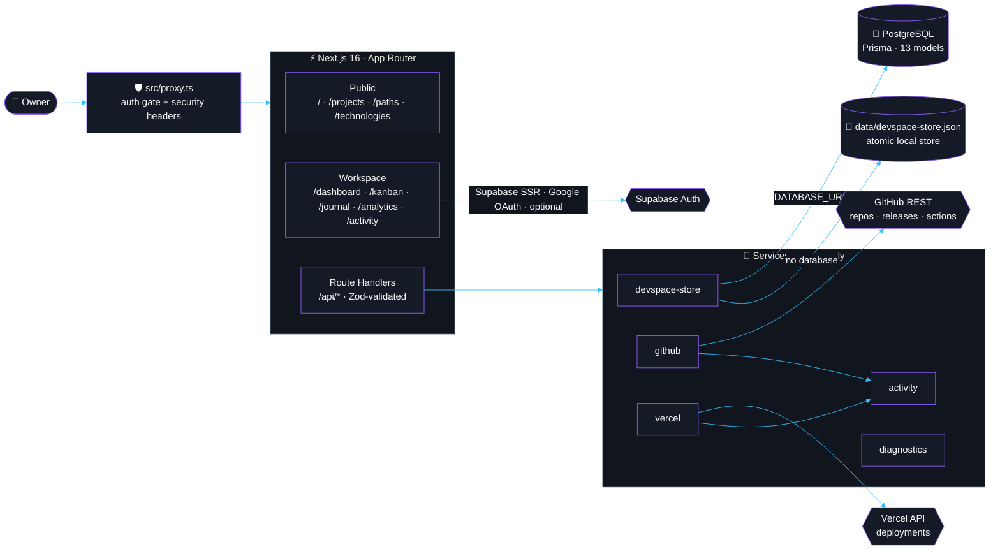

<div align="center">

<a href="#readme-top"></a>

<br>

<a name="readme-top"></a>


<br>


<br><br>

<code>&nbsp;❯ <a href="#boot">boot</a>&nbsp;</code>
<code>&nbsp;❯ <a href="#manifesto">manifesto</a>&nbsp;</code>
<code>&nbsp;❯ <a href="#catalogue">catalogue</a>&nbsp;</code>
<code>&nbsp;❯ <a href="#features">features</a>&nbsp;</code>
<code>&nbsp;❯ <a href="#workflow">workflow</a>&nbsp;</code>
<code>&nbsp;❯ <a href="#architecture">architecture</a>&nbsp;</code>
<code>&nbsp;❯ <a href="#quick-start">quick&nbsp;start</a>&nbsp;</code>
<code>&nbsp;❯ <a href="#scripts">scripts</a>&nbsp;</code>

</div>


<a name="boot"></a>

## ⟩_ 00 · Boot sequence

```text
┌─ arman@devspace ─────────────────────────────────────────────────────────────┐
│  $ whoami                                                                    │
│  a personal engineering workspace for one long, deliberate journey:          │
│  discover, inspect, modernize, document, test and ship 100 real projects —   │
│  each in its own isolated workspace, none coupled to the app's own stack.    │
└──────────────────────────────────────────────────────────────────── ● online ┘
```

**Arman's Devspace** is not a portfolio template and not a todo list. It is a cockpit: a Next.js 16 app that holds a canonical, numbered catalogue of **100 software projects**, gives every one of them a full **15-section workspace**, and wires in **live GitHub, CI/CD and deployment intelligence** so the state of the journey is always real, never invented.

<div align="center">

</div>


<a name="manifesto"></a>

## ⟩_ 01 · The manifesto

<table>
<tr>
<td width="25%" valign="top">

### 🔭 Explore.
Read code you didn't write. Every slot links to a real upstream repository, verified live against the GitHub API — anomalies flagged, never hidden.

</td>
<td width="25%" valign="top">

### 🧱 Build.
Rebuild it with a modern stack. Each workspace carries an original-vs-modernized architecture editor, tasks, milestones and notes.

</td>
<td width="25%" valign="top">

### 💥 Break.
Test it until it cracks. Testing summaries, CI run status and deployment failures surface straight into the Activity Center.

</td>
<td width="25%" valign="top">

### ♻️ Rebuild.
Document, ship, repeat. Seven phases, seven Kanban columns, one journal — and then the next slot.

</td>
</tr>
</table>


<a name="catalogue"></a>

## ⟩_ 02 · The 100-slot catalogue

<div align="center">

</div>

The catalogue lives in [`src/data/projects.ts`](src/data/projects.ts) and is mirrored into Postgres by [`prisma/seed.ts`](prisma/seed.ts). Its rules are strict:

- **Order is sacred** — positions `#001` → `#100` never move.
- **Sources stay verbatim** — the 73 supplied repository URLs are stored exactly as given; normalisation issues live in separate `discrepancyNotes`.
- **Nothing is fabricated** — the 27 reserved slots (`#51–59`, `#66–74`, `#85–93`) say *Awaiting Source Information* and carry no invented stack, stars or features.

<details>
<summary><b>🟢 Beginner Engineering Track</b> · <code>#001–#030</code> · full-stack fundamentals, CRUD, REST, stateful UIs</summary>
<br>

| # | Project | Domain |
|:-:|:--|:--|
| `001` | Online Bookstore | E-Commerce |
| `002` | Quiz Application | Education |
| `003` | Student Portal System | Education |
| `004` | Portfolio Builder | Developer Tools |
| `005` | Blog Platform (Medium Clone) 🔵 | Social |
| `006` | Recipe Sharing Platform | Lifestyle |
| `007` | Expense Tracker | Finance |
| `008` | Fitness Tracker | Health |
| `009` | Weather Application | Utilities |
| `010` | News Aggregator | Media |
| `011` | Meme Generator | Entertainment |
| `012` | Authentication System (OAuth) | Security |
| `013` | URL Shortener | Utilities |
| `014` | Note-Taking App | Productivity |
| `015` | Code Snippet Manager | Developer Tools |
| `016` | Meal Planner App | Lifestyle |
| `017` | Restaurant Menu Management | Business |
| `018` | Budget Planning App 🔵 | Finance |
| `019` | Newsletter Platform | Media |
| `020` | Wiki System | Knowledge |
| `021` | Documentation Platform | Developer Tools |
| `022` | Location-Based Service | Travel |
| `023` | Map Visualization Tool | Data Visualization |
| `024` | Quiz Game Multiplayer | Education |
| `025` | Tic-Tac-Toe Multiplayer | Games |
| `026` | Progressive Web App Store ⚪ | Developer Tools |
| `027` | Online Course Platform | Education |
| `028` | Task Management App 🟠 | Productivity |
| `029` | Job Board Platform | Business |
| `030` | Inventory Management System | Business |

</details>

<details>
<summary><b>🟠 Intermediate Systems Track</b> · <code>#031–#050</code> · auth, RBAC, webhooks, real-time, external SDKs</summary>
<br>

| # | Project | Domain |
|:-:|:--|:--|
| `031` | Social Media Platform | Social |
| `032` | Instagram Clone | Social |
| `033` | Twitter Clone | Social |
| `034` | Real-Time Chat Application | Communication |
| `035` | LMS Platform | Education |
| `036` | Hotel Booking System | Travel |
| `037` | Restaurant Reservation System | Business |
| `038` | Movie Ticket Booking | Entertainment |
| `039` | Calendar Scheduling App | Productivity |
| `040` | Grocery Delivery App | E-Commerce |
| `041` | Banking Application | Finance |
| `042` | Cryptocurrency Dashboard | Finance |
| `043` | Invoice Management System | Business |
| `044` | Doctor Appointment System | Health |
| `045` | Car Rental System | Business |
| `046` | Travel Planner App | Travel |
| `047` | Real Estate Listing Platform | Business |
| `048` | House Rental Platform | Business |
| `049` | Email Client 🟠 | Communication |
| `050` | CRM Application | Business |

</details>

<details>
<summary><b>🔴 Advanced Architecture Track</b> · <code>#051–#100</code> · multi-tenant SaaS, queues, collaborative canvases, security</summary>
<br>

| # | Project | Domain |
|:-:|:--|:--|
| `051–059` | ░░ _reserved · awaiting source information_ ░░ | — |
| `060` | Pharmacy Management System | Health |
| `061` | Stock Market Portfolio Tracker 🔵 | Finance |
| `062` | CMS Platform | Developer Tools |
| `063` | API Testing Tool | Developer Tools |
| `064` | Data Visualization Dashboard | Data Visualization |
| `065` | Hospital Management System | Health |
| `066–074` | ░░ _reserved · awaiting source information_ ░░ | — |
| `075` | Spotify Clone | Entertainment |
| `076` | Music Streaming App | Entertainment |
| `077` | Video Conferencing App | Communication |
| `078` | Podcast Platform | Entertainment |
| `079` | Airbnb Clone | Travel |
| `080` | Flight Booking System | Travel |
| `081` | Trello Clone | Productivity |
| `082` | Notion Clone | Productivity |
| `083` | Jira Clone | Productivity |
| `084` | Kanban Board | Productivity |
| `085–093` | ░░ _reserved · awaiting source information_ ░░ | — |
| `094` | Password Manager | Security |
| `095` | Two-Factor Authentication System | Security |
| `096` | Image Recognition App | AI/ML |
| `097` | Recommendation System | AI/ML |
| `098` | Delivery Route Optimizer | Logistics |
| `099` | DevOps Dashboard | DevOps |
| `100` | Code Learning Platform | Education |

</details>

<sub>🟠 link anomaly &nbsp;·&nbsp; 🔵 collection-only (subtree / list repository) &nbsp;·&nbsp; ⚪ archived upstream — all flagged by repository intelligence, all kept visible.</sub>


<a name="features"></a>

## ⟩_ 03 · Feature tour

<table>
<tr>
<td width="50%" valign="top">

#### 🗂️ Project Explorer &nbsp;<code>/projects</code>
Search, filter by difficulty · category · technology · status · verification · bookmarks, sort, paginate. Switch between a **Grid** and an accessible, sortable **List** table.

</td>
<td width="50%" valign="top">

#### 🧪 15-section Project Workspace &nbsp;<code>/projects/[slug]</code>
Original vs. modernized architecture, local clone path, 7-phase roadmap, milestones, auto-scoring task checklist, notes, deployments, screenshots, testing summary and live GitHub sync — **per project, fully isolated**.

</td>
</tr>
<tr>
<td valign="top">

#### 🛰️ Repository Intelligence &nbsp;<code>/api/github/*</code>
Live verification of every upstream repo: existence, archive state, README, license, releases, freshness (`active` · `moderate` · `stale`) and a computed health signal. Rate limits handled gracefully, batch sync supported, **missing stats stay missing**.

</td>
<td valign="top">

#### 🚀 Deployment & CI/CD Intelligence
Latest **GitHub Actions** workflow runs per repository plus **Vercel** deployment states (`BUILDING` · `READY` · `ERROR` …) with commit SHA, ref and inspector links — when the tokens are configured, silent when they're not.

</td>
</tr>
<tr>
<td valign="top">

#### 🔔 Activity Center &nbsp;<code>/activity</code>
One notification stream for **repository · deployment · CI · workspace** events, tagged `critical` · `warning` · `success` · `info`, deduplicated, read/unread tracked, with *mark all read* and on-demand sync.

</td>
<td valign="top">

#### 📊 Dashboard & Analytics &nbsp;<code>/dashboard</code> · <code>/analytics</code>
Persisted KPIs, 7-day engineering cadence, streaks, recently touched projects, upcoming milestones, track mastery and verification audit counts.

</td>
</tr>
<tr>
<td valign="top">

#### 📋 7-column Kanban &nbsp;<code>/kanban</code>
`Backlog → Cloned → Analyzing → Planning → In Development → Testing → Completed`, with drag-and-drop **and** keyboard stage controls.

</td>
<td valign="top">

#### 📓 Engineering Journal &nbsp;<code>/journal</code>
A cross-project log filtered by `general` · `architecture` · `bug` · `solution` · `learning` — the *why* behind every rebuild.

</td>
</tr>
<tr>
<td valign="top">

#### 🧭 Learning Paths & Tech Tracker &nbsp;<code>/paths</code> · <code>/technologies</code>
Three structured tracks with outcomes and recommended skills, plus an ecosystem index computed from every project's stack.

</td>
<td valign="top">

#### ⌨️ Command Palette &nbsp;<kbd>Ctrl</kbd> / <kbd>⌘</kbd> + <kbd>K</kbd>
Jump to any route or any of the 100 projects, or flip the theme, from anywhere. Dark-first theme with Light and System modes.

</td>
</tr>
</table>


<a name="workflow"></a>

## ⟩_ 04 · The workflow engine

Every project walks the same road twice: once as a **board position**, once as a **roadmap**.

<div align="center">

<br><br>

</div>

| Phase | Branch | What happens there |
|:-:|:--|:--|
| `01` | `phase/01-clone` | Inspect the upstream URL, verify branches, record discrepancies, store the local workspace path. |
| `02` | `phase/02-analyze` | Audit dependencies, folder structure, data models, auth boundaries and technical debt. |
| `03` | `phase/03-plan` | Pick the upgraded stack, map missing features, sketch the target architecture, break down tasks. |
| `04` | `phase/04-build` | Rebuild with strict TypeScript, modular server boundaries, accessible UI and real persistence. |
| `05` | `phase/05-test` | Prove invariants, API validation and user flows with Vitest, Testing Library and Playwright. |
| `06` | `phase/06-document` | Capture architecture notes, lessons, journal entries, screenshots and docs. |
| `07` | `phase/07-ship` | Publish preview/production URLs, log release metadata, review metrics, close the milestone. |


<a name="architecture"></a>

## ⟩_ 05 · Architecture



<details>
<summary><b>🔐 Security model</b></summary>
<br>

| Layer | Guard |
|:--|:--|
| Sessions | `HS256` JWT via `jose` in an `HttpOnly`, `SameSite=Lax` cookie |
| Passwords | Node `scrypt` hashing with timing-safe comparison |
| Ownership | First owner claimed only with `DEVSPACE_OWNER_EMAIL` + a `DEVSPACE_OWNER_BOOTSTRAP_TOKEN` (SHA-256 + `timingSafeEqual`), or a verified OAuth email |
| Routing | `src/proxy.ts` redirects unauthenticated workspace requests to `/login?redirect=…` |
| Headers | `X-Frame-Options: DENY`, `nosniff`, strict `Referrer-Policy`, locked-down `Permissions-Policy` |
| Indexing | Private routes ship `X-Robots-Tag: noindex, nofollow`; `robots.ts` + `sitemap.ts` agree |
| Input | Every route handler parses with Zod; `javascript:` / `data:` URLs are rejected |
| Secrets | DB clients, tokens and password logic are `import "server-only"` |

</details>

<details>
<summary><b>🗺️ Route map</b></summary>
<br>

| Surface | Routes |
|:--|:--|
| **Public** | `/` · `/projects` · `/projects/[slug]` · `/paths` · `/paths/[level]` · `/technologies` · `/login` · `/register` |
| **Workspace** *(sign-in)* | `/dashboard` · `/kanban` · `/journal` · `/analytics` · `/activity` |
| **Auth API** | `/api/auth/register` · `login` · `logout` · `me` · `callback` |
| **Projects API** | `/api/projects` · `/api/projects/[slug]` · `…/progress` · `…/tasks` · `…/notes` · `…/roadmap` · `…/milestones` · `…/deployments` · `…/screenshots` |
| **Intelligence API** | `/api/github/verify` · `/api/github/sync` · `/api/activity` · `/api/activity/[id]` · `/api/activity/sync` · `/api/activity/mark-all-read` |
| **Ops API** | `/api/health` · `/api/diagnostics` · `/api/notes` |

</details>

<details>
<summary><b>🧬 Data model</b> · 13 Prisma models</summary>
<br>

`User` · `ProjectCategory` · `Project` · `ProjectTechnology` · `UserProjectProgress` · `ProjectTask` · `ProjectNote` · `ProjectRoadmap` · `ProjectScreenshot` · `ProjectMilestone` · `ProjectActivity` · `RepositoryMetadata` · `DeploymentRecord`

No database yet? The app runs fully on the atomic JSON store, and `npm run db:migrate-json` previews the move to Postgres when you're ready.

</details>


<a name="quick-start"></a>

## ⟩_ 06 · Quick start

<div align="center">

</div>

**Zero-infrastructure mode** — runs on the local JSON store, no database needed:

```bash
git clone https://github.com/arman080325/arman-devspace.git
cd arman-devspace
npm install
cp .env.example .env
npm run dev
```

Open **http://localhost:3000**, register on `/register`, and the workspace is yours.

**Full Postgres mode** — set `DATABASE_URL` / `DIRECT_URL` in `.env`, then:

```bash
docker compose up -d
npx prisma generate
npx prisma db push
npm run db:seed
```

> [!TIP]
> `npm run db:seed` is idempotent — it writes the 100 canonical positions in order and can be re-run safely.


<a name="environment"></a>

## ⟩_ 07 · Environment

| Variable | Required | Purpose |
|:--|:-:|:--|
| `SESSION_SECRET` | ✅ | 32+ char secret that signs session cookies |
| `NEXT_PUBLIC_SITE_URL` | ✅ | Public base URL (metadata, sitemap) |
| `DATABASE_URL` · `DIRECT_URL` | ◻️ | PostgreSQL / Supabase Postgres — omit to use the local JSON store |
| `NEXT_PUBLIC_SUPABASE_URL` · `NEXT_PUBLIC_SUPABASE_ANON_KEY` | ◻️ | Enables Supabase Auth and Google OAuth |
| `GITHUB_TOKEN` | ◻️ | Lifts the GitHub API limit from 60 to 5,000 req/hr |
| `VERCEL_TOKEN` · `VERCEL_PROJECT_ID` · `VERCEL_TEAM_ID` | ◻️ | Turns on deployment intelligence |
| `DEVSPACE_OWNER_EMAIL` · `DEVSPACE_OWNER_BOOTSTRAP_TOKEN` | ◻️ | Locks first-owner claim to a known email + 16+ char token |

<sub>✅ needed · ◻️ optional — every integration degrades gracefully when its variables are absent.</sub>


<a name="scripts"></a>

## ⟩_ 08 · Command reference

| Command | Does |
|:--|:--|
| `npm run dev` | Start the dev server |
| `npm run build` · `npm run start` | Build and serve the production bundle |
| `npm run typecheck` | `tsc --noEmit` on strict TypeScript |
| `npm run lint` · `npm run format:check` | ESLint and Prettier gates |
| `npm test` · `npm run test:watch` | Vitest unit, integration and component suites |
| `npm run test:e2e` | Playwright end-to-end flows |
| `npm run db:generate` · `db:validate` · `db:push` · `db:migrate` | Prisma client, schema checks and migrations |
| `npm run db:seed` | Seed the 100 canonical positions |
| `npm run db:migrate-json` | Dry-run migration from the JSON store into Postgres |

### Quality gates

Every push and pull request to `main` / `master` runs [`.github/workflows/ci.yml`](.github/workflows/ci.yml):

```text
 npm ci ─▶ prisma generate ─▶ prisma validate ─▶ typecheck ─▶ lint ─▶ format:check ─▶ vitest ─▶ next build ─▶ ✔
```


<a name="stack"></a>

## ⟩_ 09 · Stack & layout

<table>
<tr>
<td width="50%" valign="top">

| Layer | Tooling |
|:--|:--|
| Framework | Next.js 16 · App Router · Cache Components |
| UI | React 19 · Tailwind CSS v4 · shadcn (`base-nova`) · Base UI · Lucide · Motion · `cmdk` |
| Forms | React Hook Form · Zod 4 |
| Data | PostgreSQL · Prisma 6 · JSON fallback store |
| Auth | `jose` JWT · `scrypt` · Supabase SSR |
| Integrations | GitHub REST · GitHub Actions · Vercel API |
| Quality | Vitest · Testing Library · Playwright · ESLint · Prettier |

</td>
<td width="50%" valign="top">

```text
arman-devspace/
├── src/
│   ├── app/            routes, layouts, /api handlers
│   │   └── (dashboard)/  private workspace
│   ├── components/     ui · layout · projects · dashboard · activity
│   ├── config/         site, design tokens, workflow
│   ├── data/           projects.ts ← the 100 slots
│   ├── lib/            auth, prisma, supabase, validations
│   ├── services/       store · github · vercel · activity
│   ├── types/
│   └── proxy.ts        auth gate + security headers
├── prisma/             schema · seed · migrate-json
├── tests/              unit · integration · e2e
└── docs/               architecture · development · deployment
```

</td>
</tr>
</table>

<details>
<summary><b>🎨 Design tokens</b></summary>
<br>

| Token | Hex | Role |
|:--|:--|:--|
|  | `#0B0D12` | Background |
|  | `#11151D` | Secondary surface |
|  | `#151B26` | Cards & popovers |
|  | `#8B5CF6` | Accent · violet |
|  | `#38BDF8` | Secondary accent · sky |
|    | `#22C55E` `#F59E0B` `#EF4444` | Beginner · Intermediate · Advanced |

</details>


<a name="docs"></a>

## ⟩_ 10 · Further reading

| 📐 [System Architecture](docs/architecture/SYSTEM_ARCHITECTURE.md) | 🛠️ [Development Guide](docs/development/DEVELOPMENT_GUIDE.md) | 🚢 [Deployment Guide](docs/deployment/DEPLOYMENT_GUIDE.md) | 📜 [Changelog](CHANGELOG.md) |
|:-:|:-:|:-:|:-:|

<br>

<div align="center">


<sub><a href="#readme-top">▲ back to the top</a></sub>
</div>
