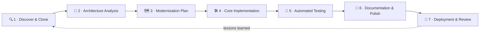
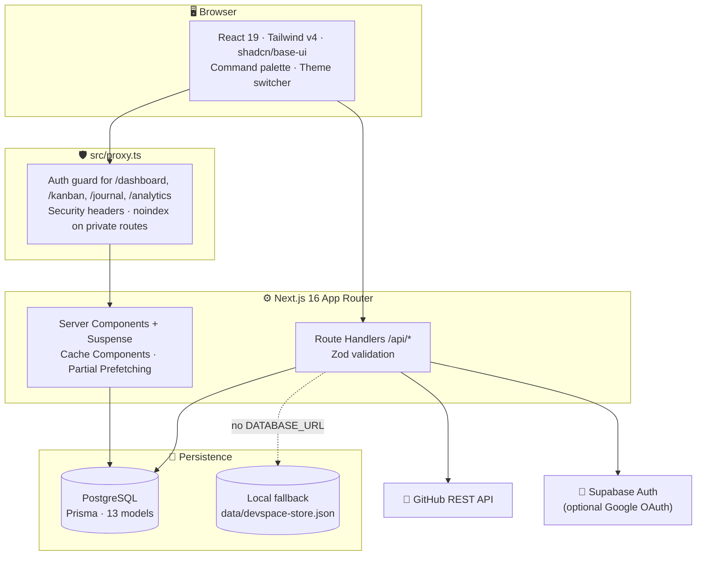
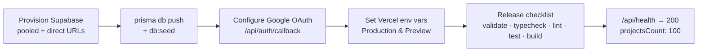

<div align="center">


# Arman's Devspace

### Explore. Build. Break. Rebuild.

**A hundred projects. One continuous engineering journey.**

A personal engineering workspace for discovering, auditing, modernizing, documenting, testing and shipping **100 software projects**, each one tracked in its own isolated workspace.

<br />

[](https://nextjs.org)
[](https://react.dev)
[](https://www.typescriptlang.org)
[](https://tailwindcss.com)
[](https://www.prisma.io)
[](https://supabase.com)


[**Overview**](#-the-mission) · [**Features**](#-whats-inside) · [**Architecture**](#-architecture) · [**Quick start**](#-quick-start) · [**Road to production**](#-road-to-production) · [**Docs**](#-documentation)

</div>

---

## 🧭 The mission

The best way to learn software engineering is to work with real code. **Arman's Devspace** is the control center for that: a curated collection of 100 open-source codebases, each taken through the same seven-phase process, from the first `git clone` to a deployed, documented and tested rebuild.

The host app stays **separate from the projects it tracks**. Every project keeps its own stack, roadmap, notes and deployment history, so modernizing project #007 never touches the Devspace platform or project #008.

<table>
<tr>
<td align="center" width="25%"><h2>100</h2><sub>Canonical project slots<br/><code>#001 → #100</code></sub></td>
<td align="center" width="25%"><h2>73</h2><sub>Source repositories<br/>URLs kept verbatim</sub></td>
<td align="center" width="25%"><h2>27</h2><sub>Reserved slots<br/>awaiting source data</sub></td>
<td align="center" width="25%"><h2>7</h2><sub>Phase modernization<br/>workflow per project</sub></td>
</tr>
</table>

> [!NOTE]
> **No fabricated data.** Supplied repository URLs are stored exactly as given, and discrepancies are flagged instead of silently fixed. The reserved slots (`#51–59`, `#66–74`, `#85–93`) are clearly marked *Awaiting Source Information*, and GitHub stats are shown only when the live API returns them.

---

## 🔁 The engineering loop

Every project goes through the same seven-phase lifecycle, and the **Kanban board** tracks where each one stands.



| Kanban stage | Meaning |
| :-- | :-- |
| `Backlog` | Queued for evaluation and initial scoping |
| `Cloned` | Source repository inspected and cloned locally |
| `Analyzing` | Auditing the original stack, patterns and missing features |
| `Planning` | Target architecture and task breakdown defined |
| `In Development` | Rebuild in progress |
| `Testing` | Verifying invariants and user flows |
| `Completed` | Shipped, documented and reviewed |

**Learning tracks:** 🟢 Beginner `#001–030` · 🟡 Intermediate `#031–050` · 🔴 Advanced `#051–100`

---

## ✨ What's inside

<table>
<tr>
<td width="50%" valign="top">

### 🗂️ Project Explorer &nbsp;<code>/projects</code>
All 100 projects in strict numerical order, with **Grid** and sortable **Table** views. Search and filter by difficulty, category, technology, status, verification or bookmark, with pagination.

</td>
<td width="50%" valign="top">

### 🧱 Project Workspace &nbsp;<code>/projects/[slug]</code>
A 15-section workspace for each project: original vs. modernized architecture, local clone path, 7-phase roadmap, milestones, a task checklist that updates completion %, notes, deployments, screenshots, a testing summary and live GitHub sync.

</td>
</tr>
<tr>
<td width="50%" valign="top">

### 🛰️ GitHub Intelligence &nbsp;<code>/api/github/verify</code>
Checks that each upstream repository exists and flags subtree, whitespace and mismatch anomalies. It caches stars, forks, issues and language, and backs off when GitHub rate limits are hit.

</td>
<td width="50%" valign="top">

### 📊 Dashboard &nbsp;<code>/dashboard</code>
Saved KPIs, 7-day engineering activity, active and recently opened projects, your streak, recent notes and upcoming milestones.

</td>
</tr>
<tr>
<td width="50%" valign="top">

### 🧩 Kanban &nbsp;<code>/kanban</code>
A seven-column pipeline with drag-and-drop **and** keyboard stage controls, so it works without a mouse.

</td>
<td width="50%" valign="top">

### 📓 Engineering Journal &nbsp;<code>/journal</code>
A filterable technical log covering all projects, with `general`, `architecture`, `bug`, `solution` and `learning` entries.

</td>
</tr>
<tr>
<td width="50%" valign="top">

### 📈 Analytics &nbsp;<code>/analytics</code>
Track mastery, repository audit counts, a status funnel and 7-day activity in one place.

</td>
<td width="50%" valign="top">

### 🧠 Paths & Technologies &nbsp;<code>/paths</code> · <code>/technologies</code>
Structured beginner, intermediate and advanced tracks, plus a technology index built from every project's stack.

</td>
</tr>
</table>

**Everywhere:** ⌘K / Ctrl+K command palette across all 100 projects · dark-first theme with Light and System modes · accessible navigation with skip links and a mobile sheet · SEO-aware `robots` and `sitemap` that keep private routes out of search results.

---

## 🏗️ Architecture



| Principle | How it's done |
| :-- | :-- |
| **Workspace independence** | Each project keeps its own source URL, stack diagrams, roadmap, tasks, notes and deployment history, separate from the host app |
| **Canonical data fidelity** | Numbering `1–100` is fixed in `src/data/projects.ts` and `prisma/seed.ts`, and discrepancies are kept in `discrepancyNotes` |
| **Dual persistence** | Prisma + PostgreSQL in production, with an atomic JSON store so everything also works with no database |
| **Secure by default** | `jose` HS256 JWT in an `HttpOnly` cookie, timing-safe `scrypt` password hashing, `server-only` boundaries, and URL schemes like `javascript:` and `data:` rejected |

<details>
<summary><b>🗺️ Full route & API map</b></summary>

<br />

**Public**

| Route | Purpose |
| :-- | :-- |
| `/` | Landing page with live workspace statistics |
| `/projects` | 100-project explorer |
| `/projects/[slug]` | Project specification & interactive workspace |
| `/paths`, `/paths/[level]` | Beginner, intermediate and advanced tracks |
| `/technologies` | Technology index |
| `/login`, `/register` | Account access |

**Protected (signed-in workspace owner)**

| Route | Purpose |
| :-- | :-- |
| `/dashboard` | KPIs, activity, streak, notes, milestones |
| `/kanban` | 7-column workflow pipeline |
| `/journal` | Engineering journal |
| `/analytics` | Mastery, audits, funnel, activity |

**Route handlers**

| Endpoint | Purpose |
| :-- | :-- |
| `GET /api/health` | Health, canonical count (`100`), storage mode |
| `/api/auth/{register,login,logout,me,callback}` | Account & session lifecycle |
| `/api/projects`, `/api/projects/[slug]` | Filtered listing & workspace payloads |
| `/api/projects/[slug]/{progress,tasks,notes,roadmap,milestones,deployments,screenshots}` | Authenticated CRUD |
| `/api/notes` | Notes across all projects |
| `/api/github/verify` | Live repository inspection & discrepancy check |

</details>

<details>
<summary><b>📁 Repository layout</b></summary>

```text
arman-devspace/
├── prisma/                 # schema.prisma (13 models) + idempotent seed
├── src/
│   ├── app/                # App Router pages, (dashboard) group, /api route handlers
│   ├── components/         # ui · layout · projects · dashboard · auth
│   ├── config/             # site, design tokens, workflow phases & Kanban columns
│   ├── data/projects.ts    # the 100 canonical project slots
│   ├── lib/                # auth, prisma, validations, supabase, helpers
│   ├── services/           # devspace-store (persistence) · github intelligence
│   └── proxy.ts            # route protection + security headers
├── tests/                  # unit · integration · e2e
├── docs/                   # architecture · development · deployment
└── docker-compose.yml      # local PostgreSQL 16
```

</details>

---

## 🧰 Tech stack

| Layer | Tools |
| :-- | :-- |
| **Framework** | Next.js 16 (App Router, Cache Components, Partial Prefetching, `proxy.ts`) |
| **Language** | TypeScript with `strict: true` |
| **UI** | React 19 · Tailwind CSS v4 · shadcn (`base-nova` / `@base-ui/react`) · Lucide · `motion` · `cmdk` · `next-themes` |
| **Forms** | React Hook Form + Zod |
| **Data** | PostgreSQL 16 · Prisma ORM · atomic JSON fallback store |
| **Auth** | `jose` JWT sessions · `scrypt` hashing · Supabase SSR (optional Google OAuth) |
| **Quality** | Vitest · Testing Library · Playwright · ESLint · Prettier · GitHub Actions |

---

## ⚡ Quick start

> **Requirements:** Node.js 22+ and npm. Docker is optional, for local PostgreSQL.

**1 · Run with no database**, using the built-in JSON store:

```bash
npm install
```

```bash
cp .env.example .env
```

```bash
npm run dev
```

Open <http://localhost:3000>, then **register on `/register`**. The first account becomes the workspace owner.

**2 · Run with PostgreSQL**, the same setup as production:

```bash
docker compose up -d
```

```bash
npx prisma generate && npx prisma db push
```

```bash
npm run db:seed
```

### 🔑 Environment variables

| Variable | Required | Purpose |
| :-- | :--: | :-- |
| `SESSION_SECRET` | ✅ | Signs session cookies. Generate with `openssl rand -base64 32` |
| `NEXT_PUBLIC_SITE_URL` | ✅ | Canonical public URL |
| `DATABASE_URL` / `DIRECT_URL` | ➖ | PostgreSQL connection. Without it, the JSON store is used |
| `GITHUB_TOKEN` | ➖ | Raises the GitHub API limit from 60 to 5,000 requests/hour |
| `NEXT_PUBLIC_SUPABASE_URL` / `NEXT_PUBLIC_SUPABASE_ANON_KEY` | ➖ | Turns on Supabase Google OAuth |

### 📜 Scripts

| Command | What it does |
| :-- | :-- |
| `npm run dev` | Start the development server |
| `npm run build` · `npm run start` | Build and serve the production bundle |
| `npm run typecheck` | `tsc --noEmit` |
| `npm run lint` · `npm run format:check` | ESLint and Prettier checks |
| `npm test` · `npm run test:watch` | Vitest unit & component tests |
| `npm run test:e2e` | Playwright end-to-end tests |
| `npm run db:validate` · `npm run db:push` · `npm run db:migrate` | Prisma schema workflows |
| `npm run db:seed` | Seed the 100 canonical project slots |

---

## ✅ Quality gates

Every push and pull request to `main`/`master` runs the **CI pipeline** in `.github/workflows/ci.yml`:

```text
npm ci → prisma generate → prisma validate → typecheck → lint → format:check → vitest → next build
```

| Suite | Location | Covers |
| :-- | :-- | :-- |
| Unit | `tests/unit` | Auth, validation schemas, GitHub service, the 100-project catalogue |
| Integration | `tests/integration` | Project card rendering |
| End-to-end | `tests/e2e` | Main user flows in a real browser |

---

## 🚀 Road to production

**Target platform:** **Vercel** for the app, with **Supabase** for PostgreSQL and authentication.



### Roadmap

- [x] **Phase 1 · Foundation & branding:** identity, theme tokens, navigation, command palette
- [x] **Phase 2 · Core interface:** 100-project catalogue, explorer, learning paths, project workspaces
- [x] **Phases 3–5 · Persistence & intelligence:** Prisma schema, data layer, auth, Kanban, journal, analytics, GitHub verification
- [x] **Phase 6 · Hardening:** SEO rules, security headers, CI workflow, Vitest & Playwright suites, documentation
- [ ] **Go live:** deploy to Vercel with Supabase PostgreSQL and Google OAuth
- [ ] **Fill the reserved slots:** add source repositories for `#51–59`, `#66–74` and `#85–93`
- [ ] **Work through the 100:** move each project from `Backlog` to `Completed`, with journal notes and live deployments

See the full [Deployment Guide](docs/deployment/DEPLOYMENT_GUIDE.md) for step-by-step instructions and the release checklist.

---

## 📚 Documentation

| Document | What you'll find |
| :-- | :-- |
| [System Architecture](docs/architecture/SYSTEM_ARCHITECTURE.md) | Design principles, security boundaries, route & API map |
| [Development Guide](docs/development/DEVELOPMENT_GUIDE.md) | Local setup, conventions and workflows |
| [Deployment Guide](docs/deployment/DEPLOYMENT_GUIDE.md) | Vercel + Supabase setup and release checklist |
| [Changelog](CHANGELOG.md) | Milestones by release |

---

<div align="center">

**Built by Arman, one repository at a time.**

<sub><i>Explore. Build. Break. Rebuild.</i></sub>

</div>
