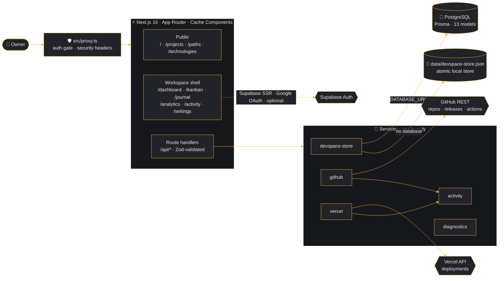

<a name="readme-top"></a>

<div align="center">

<picture>
  <source media="(prefers-color-scheme: dark)" srcset=".github/assets/readme/hero-night.svg">
  <source media="(prefers-color-scheme: light)" srcset=".github/assets/readme/hero-day.svg">
  
</picture>

<sub>☾ switch your GitHub theme: the hero changes from <b>Night Shift</b> to <b>Day Shift</b>, just like the app.</sub>

<br><br>


<br>


<br><br>

<kbd>&nbsp;<a href="#shift-log">#000&nbsp;shift&nbsp;log</a>&nbsp;</kbd>
<kbd>&nbsp;<a href="#the-loop">#001&nbsp;the&nbsp;loop</a>&nbsp;</kbd>
<kbd>&nbsp;<a href="#the-hundred">#002&nbsp;the&nbsp;hundred</a>&nbsp;</kbd>
<kbd>&nbsp;<a href="#instruments">#003&nbsp;instruments</a>&nbsp;</kbd>
<kbd>&nbsp;<a href="#keyboard">#004&nbsp;keyboard</a>&nbsp;</kbd>
<kbd>&nbsp;<a href="#pipeline">#005&nbsp;pipeline</a>&nbsp;</kbd>
<br>
<kbd>&nbsp;<a href="#wiring">#006&nbsp;wiring</a>&nbsp;</kbd>
<kbd>&nbsp;<a href="#ignition">#007&nbsp;ignition</a>&nbsp;</kbd>
<kbd>&nbsp;<a href="#environment">#008&nbsp;environment</a>&nbsp;</kbd>
<kbd>&nbsp;<a href="#commands">#009&nbsp;commands</a>&nbsp;</kbd>
<kbd>&nbsp;<a href="#materials">#010&nbsp;materials</a>&nbsp;</kbd>
<kbd>&nbsp;<a href="#further-reading">#011&nbsp;further&nbsp;reading</a>&nbsp;</kbd>

</div>


<a name="shift-log"></a>

## `#000` &nbsp;Shift log

```text
┌─ arman@devspace ──────────────────────────────────────────────── ● night shift ─┐
│ $ whoami                                                                        │
│ one engineer, one hundred numbered projects, one long deliberate journey:       │
│ discover · inspect · modernize · document · test · ship — then do it again.     │
│                                                                                 │
│ $ cat ./rules                                                                   │
│ 1. order is sacred        #001 → #100, never reshuffled                         │
│ 2. sources stay verbatim  every supplied URL is stored exactly as given         │
│ 3. nothing is invented    no fake stars, no fake stacks, no fake status         │
└─────────────────────────────────────────────────────────────────────────────────┘
```

**Arman's Devspace** is a cockpit, not a portfolio template. It's a Next.js 16 app holding a numbered catalogue of **100 software projects**. Each project gets its own **isolated workspace**, and the app wires in **live GitHub, CI and Vercel signals**, so the board always shows what is actually happening.

The interface runs on a sodium-lamp palette called **Night Shift**, with a paper-toned **Day Shift** for daylight. It's built around one idea: every project is a cell in a 10 × 10 grid, and the shape of the cell tells you where it is in the loop.

<div align="center">

</div>


<a name="the-loop"></a>

## `#001` &nbsp;The Loop

<div align="center">

</div>

The tagline is the state machine. Every project sits at exactly one point of the loop, and that state comes **from real data only** (see [`src/lib/hundred-utils.ts`](src/lib/hundred-utils.ts)):

| Phase | Derived from | Means |
|:--|:--|:--|
| 🔵 **Exploring** | `awaiting` · `backlog` · `cloned` | Idea, research or spike. No stable build yet. |
| 🟡 **Building** | `in-development` · `testing` | Active development. |
| 🔴 **Breaking** | latest workflow run failed · repo health `unavailable` | Needs attention: failing CI, failed deploy or degraded health. |
| 🟣 **Rebuilding** | `analyzing` · `planning` | Refactor, rewrite, v2 or migration. |
| 🟢 **Shipped** | `completed` | Live or complete, and healthy. |
| ⚫ **Archived** | upstream archived | No longer maintained. |
| ◽ **No data** | reserved slot | Nothing to show yet, and nothing made up. |

Loops are counted too. A project that comes back around reads *Rebuilt once*, *Rebuilt twice*, *Rebuilt 3 times* in its loop track.

<div align="center">

</div>

> [!NOTE]
> **Colour is never the only signal.** Every phase also has its own cell shape: dashed, half-filled, cracked, notched or solid. Turn the colour off (as the plate above does every few seconds) and the grid still reads.


<a name="the-hundred"></a>

## `#002` &nbsp;The Hundred

<div align="center">

</div>

The catalogue lives in [`src/data/projects.ts`](src/data/projects.ts), and [`prisma/seed.ts`](prisma/seed.ts) mirrors it into Postgres. **73** slots point at real upstream repositories. **27** slots (`#051–059`, `#066–074`, `#085–093`) are reserved and marked *Awaiting Source Information*, with no stack, stars or features filled in.

**Try it in the app:** type `0` `8` `1` anywhere in the workspace. A toast shows `#081 Trello Clone`, and <kbd>↵</kbd> takes you there.

<details>
<summary><b>🟢 Beginner Engineering Track</b> · <code>#001–#030</code> · full-stack fundamentals, CRUD, REST, stateful UIs</summary>
<br>

| # | Project | Domain |
|:-:|:--|:--|
| `001` | Online Bookstore | E-Commerce |
| `002` | Quiz Application | Education |
| `003` | Student Portal System | Education |
| `004` | Portfolio Builder | Developer Tools |
| `005` | Blog Platform (Medium Clone) ◎ | Social |
| `006` | Recipe Sharing Platform | Lifestyle |
| `007` | Expense Tracker | Finance |
| `008` | Fitness Tracker | Health |
| `009` | Weather Application | Utilities |
| `010` | News Aggregator | Media |
| `011` | Meme Generator | Entertainment |
| `012` | Authentication System (OAuth) | Security |
| `013` | URL Shortener | Utilities |
| `014` | Note-Taking App | Productivity |
| `015` | Code Snippet Manager | Developer Tools |
| `016` | Meal Planner App | Lifestyle |
| `017` | Restaurant Menu Management | Business |
| `018` | Budget Planning App ◎ | Finance |
| `019` | Newsletter Platform | Media |
| `020` | Wiki System | Knowledge |
| `021` | Documentation Platform | Developer Tools |
| `022` | Location-Based Service | Travel |
| `023` | Map Visualization Tool | Data Visualization |
| `024` | Quiz Game Multiplayer | Education |
| `025` | Tic-Tac-Toe Multiplayer | Games |
| `026` | Progressive Web App Store ▣ | Developer Tools |
| `027` | Online Course Platform | Education |
| `028` | Task Management App ⚠ | Productivity |
| `029` | Job Board Platform | Business |
| `030` | Inventory Management System | Business |

</details>

<details>
<summary><b>🟡 Intermediate Systems Track</b> · <code>#031–#050</code> · auth, RBAC, webhooks, real-time, external SDKs</summary>
<br>

| # | Project | Domain |
|:-:|:--|:--|
| `031` | Social Media Platform | Social |
| `032` | Instagram Clone | Social |
| `033` | Twitter Clone | Social |
| `034` | Real-Time Chat Application | Communication |
| `035` | LMS Platform | Education |
| `036` | Hotel Booking System | Travel |
| `037` | Restaurant Reservation System | Business |
| `038` | Movie Ticket Booking | Entertainment |
| `039` | Calendar Scheduling App | Productivity |
| `040` | Grocery Delivery App | E-Commerce |
| `041` | Banking Application | Finance |
| `042` | Cryptocurrency Dashboard | Finance |
| `043` | Invoice Management System | Business |
| `044` | Doctor Appointment System | Health |
| `045` | Car Rental System | Business |
| `046` | Travel Planner App | Travel |
| `047` | Real Estate Listing Platform | Business |
| `048` | House Rental Platform | Business |
| `049` | Email Client ⚠ | Communication |
| `050` | CRM Application | Business |

</details>

<details>
<summary><b>🔴 Advanced Architecture Track</b> · <code>#051–#100</code> · multi-tenant SaaS, queues, collaborative canvases, security</summary>
<br>

| # | Project | Domain |
|:-:|:--|:--|
| `051–059` | ▨▨ _reserved · awaiting source information_ ▨▨ | — |
| `060` | Pharmacy Management System | Health |
| `061` | Stock Market Portfolio Tracker ◎ | Finance |
| `062` | CMS Platform | Developer Tools |
| `063` | API Testing Tool | Developer Tools |
| `064` | Data Visualization Dashboard | Data Visualization |
| `065` | Hospital Management System | Health |
| `066–074` | ▨▨ _reserved · awaiting source information_ ▨▨ | — |
| `075` | Spotify Clone | Entertainment |
| `076` | Music Streaming App | Entertainment |
| `077` | Video Conferencing App | Communication |
| `078` | Podcast Platform | Entertainment |
| `079` | Airbnb Clone | Travel |
| `080` | Flight Booking System | Travel |
| `081` | Trello Clone | Productivity |
| `082` | Notion Clone | Productivity |
| `083` | Jira Clone | Productivity |
| `084` | Kanban Board | Productivity |
| `085–093` | ▨▨ _reserved · awaiting source information_ ▨▨ | — |
| `094` | Password Manager | Security |
| `095` | Two-Factor Authentication System | Security |
| `096` | Image Recognition App | AI/ML |
| `097` | Recommendation System | AI/ML |
| `098` | Delivery Route Optimizer | Logistics |
| `099` | DevOps Dashboard | DevOps |
| `100` | Code Learning Platform | Education |

</details>

<sub>⚠ link anomaly (owner segment contains a space) &nbsp;·&nbsp; ◎ collection-only source (monorepo / curated list) &nbsp;·&nbsp; ▣ archived upstream &nbsp;·&nbsp; ▨ reserved. Repository intelligence flags all of these, and none of them are hidden.</sub>


<a name="instruments"></a>

## `#003` &nbsp;Instruments

The console, panel by panel.

<div align="center">

</div>

<table>
<tr>
<td width="50%" valign="top">

#### ▦ &nbsp;Overview &nbsp;<code>/dashboard</code>
**The Hundred** as a hero grid, with spec plates on hover, a pinned-project shelf, workspace metrics, category distribution and a live signal stream. Arrow keys move around the grid and <kbd>↵</kbd> opens a cell.

</td>
<td width="50%" valign="top">

#### ☰ &nbsp;All projects &nbsp;<code>/projects</code>
Three views: **Field** (the grid), **Plates** (cards) and **List** (an accessible table that sorts by number · name · category · phase · difficulty · health · last commit, and pages through results). Search by number (`031`), title or tech, then narrow by phase · category · complexity · technology · health · pinned.

</td>
</tr>
<tr>
<td valign="top">

#### ◫ &nbsp;Project workspace &nbsp;<code>/projects/[slug]</code>
Seven tabs: **Overview · Roadmap · Milestones · GitHub · Deployments · Activity · Docs**. It holds original vs. modernized stack, local clone path, the 7-phase roadmap, an auto-scored task checklist, notes, screenshots and a testing summary. Each workspace is **fully isolated** from the others.

</td>
<td valign="top">

#### ⌥ &nbsp;Repository intelligence &nbsp;<code>/technologies</code> · <code>/api/github/*</code>
Checks every upstream repo live: existence, archive state, README, license, releases, freshness (`active` · `moderate` · `stale`), latest workflow run and a computed health signal. It handles rate limits and supports batch sync. **If a stat is missing, it shows as missing.**

</td>
</tr>
<tr>
<td valign="top">

#### ◉ &nbsp;Activity &nbsp;<code>/activity</code>
One logbook for **repository · deployment · CI · workspace** events, tagged `critical` · `warning` · `success` · `info`. Events are deduplicated and tracked as read or unread, with *mark all read* and on-demand sync.

</td>
<td valign="top">

#### ⇢ &nbsp;Roadmaps &nbsp;<code>/kanban</code>
A 7-column board: `Backlog → Cloned → Analyzing → Planning → In Development → Testing → Completed`. Move cards with drag-and-drop **or** keyboard stage controls.

</td>
</tr>
<tr>
<td valign="top">

#### ✎ &nbsp;Journal &nbsp;<code>/journal</code>
A cross-project engineering log filtered by `general` · `architecture` · `bug` · `solution` · `learning`. It records *why* each rebuild happened.

</td>
<td valign="top">

#### ▁▃▅ &nbsp;Analytics &nbsp;<code>/analytics</code>
Saved KPIs, 7-day engineering cadence, streaks, track mastery and verification audit counts.

</td>
</tr>
<tr>
<td valign="top">

#### ⚙ &nbsp;Settings &nbsp;<code>/settings</code>
Profile, **Appearance** (Night Shift · Day Shift · System, comfortable/compact density, reduce motion), Workspace defaults (Field · Plates · List), account security and **Integrations**. Integrations shows live GitHub, Vercel and Supabase/Postgres diagnostics.

</td>
<td valign="top">

#### ⧉ &nbsp;Learning paths &nbsp;<code>/paths</code>
Three tracks (Beginner, Intermediate, Advanced) with outcomes and recommended skills, plus a technology index built from every project's stack.

</td>
</tr>
</table>

<div align="center">

</div>


<a name="keyboard"></a>

## `#004` &nbsp;Keyboard-first

<div align="center">

</div>

| Chord | Goes to | | Chord | Goes to |
|:--|:--|:-:|:--|:--|
| <kbd>⌘</kbd>/<kbd>Ctrl</kbd> + <kbd>K</kbd> | Command palette (routes, all 100 projects, theme) | | <kbd>g</kbd> <kbd>i</kbd> | Repository intelligence |
| <kbd>g</kbd> <kbd>o</kbd> | Overview | | <kbd>g</kbd> <kbd>j</kbd> | Journal |
| <kbd>g</kbd> <kbd>p</kbd> | All projects | | <kbd>g</kbd> <kbd>y</kbd> | Analytics |
| <kbd>g</kbd> <kbd>c</kbd> | Categories | | <kbd>g</kbd> <kbd>s</kbd> | Settings |
| <kbd>g</kbd> <kbd>a</kbd> | Activity | | <kbd>[</kbd> | Collapse / expand sidebar |
| <kbd>g</kbd> <kbd>r</kbd> | Roadmaps | | <kbd>0</kbd>–<kbd>9</kbd> … <kbd>↵</kbd> | Jump to project `#NNN` (<kbd>Esc</kbd> cancels) |


<a name="pipeline"></a>

## `#005` &nbsp;The pipeline

Each project goes through the work twice: once as a **board position**, once as a **roadmap**.

<div align="center">

</div>

| Phase | Branch | What happens there |
|:-:|:--|:--|
| `01` | `phase/01-clone` | Inspect the upstream URL, verify branches, record discrepancies, store the local workspace path. |
| `02` | `phase/02-analyze` | Audit dependencies, folder structure, data models, auth boundaries and technical debt. |
| `03` | `phase/03-plan` | Pick the upgraded stack, map missing features, sketch the target architecture, break down tasks. |
| `04` | `phase/04-build` | Rebuild with strict TypeScript, modular server boundaries, accessible UI and real persistence. |
| `05` | `phase/05-test` | Prove invariants, API validation and user flows with Vitest, Testing Library and Playwright. |
| `06` | `phase/06-document` | Capture architecture notes, lessons, journal entries, screenshots and docs. |
| `07` | `phase/07-ship` | Publish preview/production URLs, log release metadata, review metrics, close the milestone. |


<a name="wiring"></a>

## `#006` &nbsp;Wiring



<details>
<summary><b>🔐 Security model</b></summary>
<br>

| Layer | Guard |
|:--|:--|
| Sessions | `HS256` JWT via `jose` in an `HttpOnly`, `SameSite=Lax` cookie |
| Passwords | Node `scrypt` hashing with timing-safe comparison |
| Ownership | The first owner can only be claimed with `DEVSPACE_OWNER_EMAIL` + `DEVSPACE_OWNER_BOOTSTRAP_TOKEN` (SHA-256 + `timingSafeEqual`), or a verified OAuth email |
| Routing | `src/proxy.ts` sends unauthenticated requests for `/dashboard`, `/activity`, `/kanban`, `/journal`, `/analytics` and `/settings` to `/login?redirect=…` |
| Headers | `X-Frame-Options: DENY`, `nosniff`, strict `Referrer-Policy`, locked-down `Permissions-Policy` |
| Indexing | Private routes send `X-Robots-Tag: noindex, nofollow`; `robots.ts` and `sitemap.ts` agree with them |
| Input | Every route handler parses input with Zod; `javascript:` / `data:` URLs are rejected |
| Secrets | DB clients, tokens and password logic are `import "server-only"` |

</details>

<details>
<summary><b>🗺️ Route map</b></summary>
<br>

| Surface | Routes |
|:--|:--|
| **Public** | `/` · `/projects` · `/projects/[slug]` · `/paths` · `/paths/[level]` · `/technologies` · `/login` · `/register` |
| **Workspace** *(sign-in)* | `/dashboard` · `/activity` · `/kanban` · `/journal` · `/analytics` · `/settings` |
| **Auth API** | `/api/auth/register` · `login` · `logout` · `me` · `callback` |
| **Projects API** | `/api/projects` · `/api/projects/[slug]` · `…/progress` · `…/tasks` · `…/notes` · `…/roadmap` · `…/milestones` · `…/deployments` · `…/screenshots` |
| **Intelligence API** | `/api/github/verify` · `/api/github/sync` · `/api/activity` · `/api/activity/[id]` · `/api/activity/sync` · `/api/activity/mark-all-read` |
| **Ops API** | `/api/health` · `/api/diagnostics` · `/api/notes` |

</details>

<details>
<summary><b>🧬 Data model</b> · 13 Prisma models</summary>
<br>

`User` · `ProjectCategory` · `Project` · `ProjectTechnology` · `UserProjectProgress` · `ProjectTask` · `ProjectNote` · `ProjectRoadmap` · `ProjectScreenshot` · `ProjectMilestone` · `ProjectActivity` · `RepositoryMetadata` · `DeploymentRecord`

No database yet? The app runs entirely on the atomic JSON store. When you're ready for Postgres, `npm run db:migrate-json` shows a preview of the move.

</details>


<a name="ignition"></a>

## `#007` &nbsp;Ignition

<div align="center">

</div>

**① Zero-infrastructure mode.** No database needed; the app uses the local JSON store:

```bash
git clone https://github.com/arman080325/arman-devspace.git
```

```bash
cd arman-devspace && npm install
```

```bash
cp .env.example .env
```

```bash
npm run dev
```

Open **http://localhost:3000**, register on `/register`, and the workspace is yours.

**② Full Postgres mode.** Set `DATABASE_URL` and `DIRECT_URL` in `.env`, then run:

```bash
docker compose up -d
```

```bash
npx prisma generate && npx prisma db push
```

```bash
npm run db:seed
```

**③ Shipping to Vercel + Supabase.** Point `DATABASE_URL` at the Supabase **transaction pooler** (port `6543`, `pgbouncer=true`) and `DIRECT_URL` at the **direct session** connection (port `5432`), which the Prisma CLI uses for migrations. Set `NEXT_PUBLIC_SITE_URL` to the deployed origin. The full checklist is in the [Deployment Guide](docs/deployment/DEPLOYMENT_GUIDE.md).

> [!TIP]
> `npm run db:seed` is idempotent. It writes the 100 canonical positions in order and is safe to run again.


<a name="environment"></a>

## `#008` &nbsp;Environment

| Variable | | Purpose |
|:--|:-:|:--|
| `SESSION_SECRET` | ● | 32+ character secret that signs session cookies |
| `NEXT_PUBLIC_SITE_URL` | ● | Public base URL for OAuth redirects, metadata and the sitemap |
| `DATABASE_URL` · `DIRECT_URL` | ○ | PostgreSQL / Supabase Postgres (pooler + direct). Leave unset to use the local JSON store |
| `NEXT_PUBLIC_SUPABASE_URL` · `NEXT_PUBLIC_SUPABASE_ANON_KEY` | ○ | Turns on Supabase Auth and Google OAuth |
| `GITHUB_TOKEN` | ○ | Raises the GitHub API limit from 60 to 5,000 requests per hour |
| `VERCEL_TOKEN` · `VERCEL_PROJECT_ID` · `VERCEL_TEAM_ID` | ○ | Turns on deployment intelligence |
| `DEVSPACE_OWNER_EMAIL` · `DEVSPACE_OWNER_BOOTSTRAP_TOKEN` | ○ | Restricts the first-owner claim to a known email and a 16+ character token |

<sub>● required &nbsp;·&nbsp; ○ optional. Each integration switches itself off quietly when its variables are missing, and <code>/settings → Integrations</code> shows which ones are live.</sub>


<a name="commands"></a>

## `#009` &nbsp;Commands & quality gates

| Command | What it does |
|:--|:--|
| `npm run dev` | Start the dev server |
| `npm run build` · `npm run start` | Build and serve the production bundle |
| `npm run typecheck` | `tsc --noEmit` on strict TypeScript |
| `npm run lint` · `npm run format:check` | ESLint and Prettier checks |
| `npm test` · `npm run test:watch` | Vitest unit, integration and component suites |
| `npm run test:e2e` | Playwright end-to-end flows |
| `npm run db:generate` · `db:validate` · `db:push` · `db:migrate` | Prisma client, schema checks and migrations |
| `npm run db:seed` | Seed the 100 canonical positions |
| `npm run db:migrate-json` | Dry-run migration from the JSON store into Postgres |

Every push and pull request to `main` / `master` runs [`.github/workflows/ci.yml`](.github/workflows/ci.yml) on Node 22:

```text
 npm ci ─▶ prisma generate ─▶ prisma validate ─▶ typecheck ─▶ lint ─▶ format:check ─▶ vitest ─▶ next build ─▶ ✔ shipped
```


<a name="materials"></a>

## `#010` &nbsp;Materials

<table>
<tr>
<td width="50%" valign="top">

| Layer | Tooling |
|:--|:--|
| Framework | Next.js 16 · App Router · Cache Components |
| UI | React 19 · Tailwind CSS v4 · shadcn (`base-nova`) · Base UI · Lucide · Motion · `cmdk` |
| Type | **Anybody** variable width (display) · Geist Sans & Mono |
| Forms | React Hook Form · Zod 4 |
| Data | PostgreSQL · Prisma 6 · JSON fallback store |
| Auth | `jose` JWT · `scrypt` · Supabase SSR |
| Integrations | GitHub REST · GitHub Actions · Vercel API |
| Quality | Vitest · Testing Library · Playwright · ESLint · Prettier |

</td>
<td width="50%" valign="top">

```text
arman-devspace/
├── src/
│   ├── app/            routes, layouts, /api handlers
│   │   └── (dashboard)/  private workspace
│   ├── components/
│   │   ├── redesign/   Hundred · SpecPlate · brand · glyphs
│   │   ├── shell/      sidebar · topbar · palette · jump
│   │   └── …           projects · dashboard · settings
│   ├── config/         site, tokens, workflow
│   ├── data/           projects.ts ← the 100 slots
│   ├── lib/            auth, prisma, hundred-utils
│   ├── services/       store · github · vercel · activity
│   └── proxy.ts        auth gate + security headers
├── prisma/             schema · seed · migrate-json
├── tests/              unit · integration · e2e
└── docs/               architecture · development · deployment
```

</td>
</tr>
</table>

<details>
<summary><b>🎨 The palette</b> · Night Shift / Day Shift</summary>
<br>

The mark is a 3 × 3 grid with **one cell knocked loose** in sodium amber: something broke, and it's being rebuilt. The tagline is set in **Anybody** at a different width per word: *Explore.* wide, *Build.* regular, *Break.* condensed with its `k` dropped a pixel, *Rebuild.* regular again.

| Token | ☾ Night Shift | ☀ Day Shift | Role |
|:--|:--|:--|:--|
| `--bg-base` |  `#1a1c20` |  `#ecece7` | Canvas |
| `--bg-surface` |  `#212328` |  `#f6f6f3` | Panels & cards |
| `--text-primary` |  `#eceae4` |  `#1d1f23` | Ink |
| `--sodium` |  `#f2b63c` |  `#f2b63c` | Focus, selection, the loose cell |
| `--ph-explore` |  `#8fb4ff` |  `#2f5fd0` | Exploring |
| `--ph-build` |  `#f2b63c` |  `#8a5a00` | Building |
| `--ph-break` |  `#ff6b57` |  `#b83226` | Breaking |
| `--ph-rebuild` |  `#a99bff` |  `#5b44c9` | Rebuilding |
| `--ph-ship` |  `#4cc3a0` |  `#0a7457` | Shipped |

<sub>Easter egg: when the hero plate at the top loads, its lamp warms from red to amber, the way a real low-pressure sodium lamp does.</sub>

</details>


<a name="further-reading"></a>

## `#011` &nbsp;Further reading

| 📐 [System Architecture](docs/architecture/SYSTEM_ARCHITECTURE.md) | 🛠️ [Development Guide](docs/development/DEVELOPMENT_GUIDE.md) | 🚢 [Deployment Guide](docs/deployment/DEPLOYMENT_GUIDE.md) | 📜 [Changelog](CHANGELOG.md) |
|:-:|:-:|:-:|:-:|

<br>

<div align="center">


<sub><a href="#readme-top">▲ back to plate #000</a></sub>
</div>
